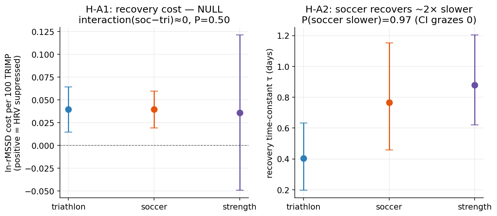
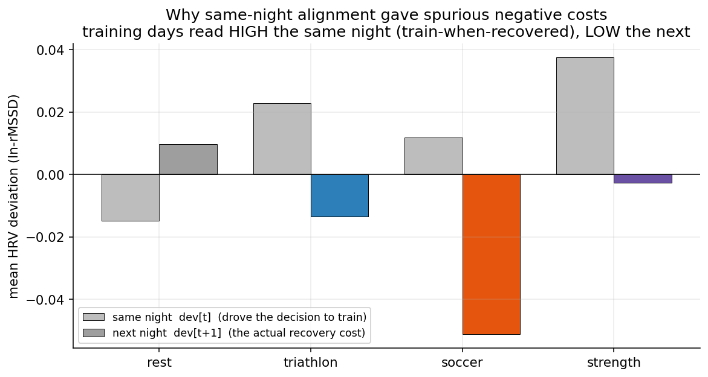

# garmin-nof1

[](https://github.com/EwanWu06/garmin-nof1/actions/workflows/tests.yml)

A single-subject (N-of-1) study of how next-night heart-rate variability (HRV) responds to
triathlon, soccer, and strength training, using about 2.5 years of my own Garmin data.

> This repository is a cleaned-up public release of a project completed in June 2026. The
> development history is kept private; commit hashes cited in the preregistration refer to it.

## Questions

- **H-A1.** Per unit of training load, does soccer lower next-night HRV more than triathlon?
- **H-A2.** Does HRV take longer to recover after soccer than after triathlon?
- **H-P1.** Does today's training load improve a next-day HRV forecast beyond an
  autoregressive baseline?

## Data

- A 904-day daily panel from a Garmin Forerunner 955: nightly HRV (ln RMSSD) on 623 days;
  training days: triathlon disciplines (run, bike, swim) 114, soccer 48, strength 90.
- 22 chest-strap sessions with beat-to-beat RR, used for a measurement check.
- The raw data are personal and are not included.

## Methods

- An analysis plan with decision thresholds was written before modeling but not registered
  on OSF ([`preregistration/`](preregistration/OSF_preregistration.md)). Deviations are logged
  in its append-only §13. Two matter most: the A-layer was fit exploratorily on the full panel
  (A3), and planned covariates and robustness runs were not carried out (A12).
- H-A1 and H-A2: within-person conjugate Bayesian regression on the 28-day-detrended
  ln RMSSD deviation, with each day's load aligned to the following night.
- H-P1: leakage-safe time-series cross-validation (purged walk-forward, combinatorial purged
  CV), with the most recent 20% of days held out and evaluated once.
- 134 tests run on synthetic data with a known ground truth; no personal data needed.

## Results

None of the three hypotheses met its pre-registered criterion.

| | Criterion | Result |
|---|---|---|
| **H-A1** | P(interaction > 0) ≥ 0.95 and 95% CrI outside a ±0.02 ROPE | Not supported. Cost per 100 TRIMP ≈ 0.039 for both sports; P ≈ 0.50 |
| **H-A2** | 95% CrI of τ<sub>soccer</sub> − τ<sub>triathlon</sub> excludes 0 | Not supported. τ: soccer 0.77 d, triathlon 0.40 d, strength 0.88 d; P(soccer slower) ≈ 0.97; 95% CrI of the difference (−0.02, 0.79) d |
| **H-P1** | 5th percentile of CPCV skill improvement > 0 | Not supported. RMSE: random walk 0.168, AR(1) 0.140, AR(1) + load 0.139 |



**Alignment.** Garmin dates overnight HRV to the morning. When a day's load was matched to
the same night, training appeared to raise HRV, because training tends to happen on days
that start well recovered. Matching load to the following night corrects this (A1).



**Measurement check.** In the 22 chest-strap sessions, uncorrected activity RMSSD was about
3× the artifact-corrected value, which supports using Garmin's overnight HRV for the daily
panel rather than activity recordings.

## Limitations

- One person; nothing here generalizes to other people.
- Observational data. Sport is entangled with season, so sport differences are associations.
- Nightly HRV is a Garmin-derived summary, not raw beats.
- TRIMP is heart-rate based and likely underestimates intermittent soccer load.
- The A-layer is exploratory (A3, A12).

## Layout

```
src/garmin_nof1/
  data/       synthetic panel with a known generative structure (test substrate)
  pipeline/   Garmin export -> tidy daily panel; FIT RR parsing; TRIMP
  eval/       leakage-safe time-series CV; agreement statistics
  models/     recovery cost (H-A1), recovery time constant (H-A2), prediction (H-P1)
scripts/      pull data, check the panel, D-layer and H-P1 reports, figures
examples/     demo of leakage in ordinary k-fold on autocorrelated data
tests/        134 tests on synthetic data
```

## Usage

```bash
pip install -e ".[dev]"
pytest
python examples/demo_cv_leakage.py
```

On your own Garmin data (the password is typed interactively and not stored; data stay in
the gitignored `data/` folder):

```bash
pip install -e ".[ingest,figures]"
python scripts/pull_garmin.py --start 2024-01-01 --end 2024-12-31 [--fits]
python scripts/check_panel.py
python scripts/prediction_report.py --hr-rest <resting HR> --hr-max <max HR>
python scripts/dlayer_report.py          # needs FITs pulled with --fits
python scripts/make_figures.py --hr-rest <resting HR> --hr-max <max HR>
```

## Note on tools

I was responsible for the study design, analysis decisions, and review of results; the code
was written by an AI coding tool.

## License

MIT
